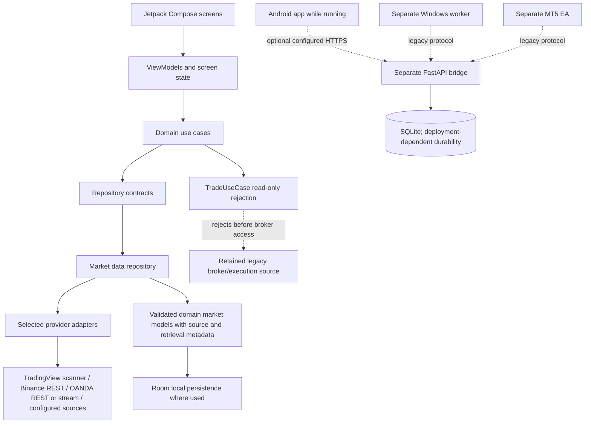

# DestinedFX Analyzer 5

DestinedFX Analyzer 5 is an Android application for market observation and educational technical analysis. The `free/phone-only-v1` branch is undergoing a read-only conversion: Android order submissions are rejected at the `TradeUseCase` boundary, but legacy transaction-capable source and separately deployable services remain in the repository. This is **not a verified read-only release** and is not financial advice.

## Purpose and current status

The intended phone product displays available market information and analysis, records local analysis history, and fails closed when relevant inputs are absent or invalid. It does not promise live data, broker-account connectivity, always-on operation, or remote hosting. Public market feeds are distinct from authenticated broker account data. No broker credentials or order access are needed for the intended analysis-only use.

The repository also contains legacy broker, bot, managed-execution bridge, Windows worker, and MT5 Expert Advisor code. The Android `TradeUseCaseImpl` rejects before broker lookup or submission, and the current Android manifest does not register the bot/session services or boot receiver, but those code paths have not all been removed or proven unreachable in every build/deployment. Do not deploy the legacy execution components or treat this branch as production-safe until the remaining conversion and its end-to-end verification are complete. See [read-only audit](docs/read-only-scope.md).

## Features present in source

- Jetpack Compose screens for analysis, strategies, calendar, risk, settings, and a read-only-scope disclosure.
- Kotlin analysis, signal, market-structure, indicator, risk, and backtest components, plus an on-device Python quantitative module.
- Market quote/candle retrieval through selected provider adapters; validation, source labeling, stale/missing-data handling, and caching.
- Local Room-backed analysis, trade, user, and retained Deriv execution records. Their presence does not imply that trading is supported by this branch.
- Android account-data provenance models and provider capability/status declarations. Genuine external account connectivity is not established by unit tests or provider names.
- Offline on-device chart-image text recognition is declared as a dependency; screenshots are not sent to a remote OCR service by that component.
- A standalone FastAPI bridge, managed-worker package, and MT5 EA are included as separate legacy/experimental components, with execution-capable routes. They are not part of a verified read-only product deployment.

These are code-level features, not a claim that each provider, service, screen, or workflow was exercised in this environment. Availability depends on configuration and upstream services.

## Screenshots

No current screenshots are maintained as authoritative release screenshots. The debug screenshot activity and screenshot tests are development tooling, not evidence of a released UI.

## Technology stack

- Android: Kotlin, Jetpack Compose, AndroidX lifecycle/navigation, Room, Preferences DataStore, AndroidX Security Crypto, Coroutines, OkHttp, Retrofit/Moshi, Protocol Buffers, and Chaquopy/Python 3.12.
- Tests: JUnit/Robolectric and Android instrumentation tests; Python tests for bridge, worker, and related utilities.
- Build/CI: Gradle wrapper, Android Gradle Plugin and Kotlin versions pinned in `gradle/libs.versions.toml`, GitHub Actions, and a debug APK artifact.
- Optional legacy backend: FastAPI/Starlette, SQLite, Docker/Compose, TLS proxy examples, and a Windows Python worker/MetaTrader 5 EA. No deployed production backend is implied.

## Repository structure

```text
app/                         Android application, Compose, domain/data code and tests
  src/main/java/com/example/  UI, Android data, DI, services and adapters
  src/main/java/com/destinedfx/ shared market/analysis/trading-core code
  src/test/                   JVM/Robolectric tests
  src/androidTest/             instrumentation tests
bridge/                      FastAPI/SQLite relay, API and Python tests
managed-worker/               Windows-side worker, diagnostics and tests
mt5-ea/                       MQL5 Expert Advisor source and tests
docs/                         Architecture, safety, providers, deployment and research
scripts/                      Boundary verifier, emulator and smoke-test helpers
.github/workflows/            Android validation/APK workflow
build.gradle.kts              Root Android/Chaquopy/Protobuf build configuration
app/build.gradle.kts          Android app configuration and dependencies
.env.example                  Public/non-secret development placeholders
```

## Architecture overview

The Android code has presentation, domain, and data responsibilities, but does not use a fully isolated multi-module architecture. `MyApplication` performs broad service/repository construction, `AppContainer` supplies the root ViewModel, and `ServiceLocator` remains as an additional lookup mechanism. Prefer existing contracts and avoid inventing duplicate modules.



The diagram deliberately labels the bridge/worker/EA path as legacy and separate; it does not claim that path is read-only, deployed, or continuously available. More detail: [system architecture](docs/architecture/SYSTEM_ARCHITECTURE.md) and [application data flow](docs/architecture/APPLICATION_DATA_FLOW.md).

## Application data flow

1. `MainActivity` initializes the app and launches the Compose workspace after application initialization.
2. Compose screens emit events to ViewModels; ViewModels call use cases and repositories rather than hosting provider-specific protocol logic.
3. `MarketDataRepositoryImpl` chooses the configured/selected source path, requests quotes or candles, validates and normalizes them, and applies cache/freshness/error handling.
4. Analysis operates on domain models. Missing or invalid bars are not converted into fabricated OHLC; the UI should preserve unavailable/stale status and source attribution.
5. Analysis history and selected other records are stored locally through Room repositories/DAOs. The legacy backend is a separate optional network system, not a required application backend for basic local analysis.

See [application data flow](docs/architecture/APPLICATION_DATA_FLOW.md) and [data provenance](docs/security/DATA_PROVENANCE.md).

## Provider architecture and public market data

Provider adapters, authenticated-account gateways, preview gateways, and unavailable gateways are separate concepts. Public quotes/candles do not prove that an account is authenticated or connected. The current capability matrix is source-based; external verification and quotas are explicitly marked unknown where no evidence exists: [public provider capability matrix](docs/providers/PROVIDER_CAPABILITY_MATRIX.md), [broker capability matrix](docs/broker-capability-matrix.md), and [provider architecture](docs/architecture/PROVIDER_ARCHITECTURE.md).

Current source paths include TradingView scanner REST snapshots, Binance Spot REST for a limited mapped crypto universe, OANDA market-data REST/stream adapters requiring configuration, and a runtime-keyed FMP economic-calendar adapter. Actual availability, pricing tier, delay, quotas, entitlement and instrument coverage have not been verified externally for this revision. The defined Binance streaming class is not currently wired into the repository stream startup path. Do not describe any of these feeds as guaranteed real-time.

Normalization preserves available provider/source identifiers and timestamps; several REST ticker adapters stamp local retrieval time rather than upstream event time. That timestamp is not proof of exchange-event freshness. Null values remain unavailable; do not replace them with zero or silently merge different provider sources. See the matrix for current limitations and tests.

## Backend and remote-service architecture

There is no required remote application backend for local Android analysis. The repo does contain a FastAPI bridge with SQLite storage and command/managed-account routes, plus separate worker/EA components. Those components are transaction-capable and are **not** a read-only service. The root `render.yaml` describes a Free, ephemeral, non-durable diagnostic configuration whose readiness path blocks execution-sensitive operation. It does not prove a deployment exists. The owner-operated deployment recipes are not verified end-to-end.

The bridge has liveness/readiness endpoints and a documented, authenticated `/v1/...` API. Its endpoints and security assumptions are documented in [backend architecture](docs/architecture/BACKEND_ARCHITECTURE.md), [managed execution protocol](docs/managed-execution-protocol.md), and [bridge README](bridge/README.md). Supabase auth and cloud-sync classes in Android are stubs, not working hosted integrations. No paid service is required or provisioned by the Android analysis path; the optional legacy bridge/worker deployment has operator-owned infrastructure and configuration requirements.

## Local storage, network, and lifecycle

Room database version 6 includes analysis, trade, user, and Deriv execution entities. SharedPreferences/DataStore and AndroidX encrypted preferences are used by various settings/secret-related components. Retention, deletion, backup/recovery, and every legacy persisted credential path require further audit; this README does not imply a complete privacy review. The main app disables backup and uses a network security config that disallows cleartext traffic and trusts system certificates.

Network work is dispatched away from the UI thread in provider/repository implementations and uses coroutine cancellation and OkHttp timeouts in several adapters. Retry, rate-limit, stream reconnection, backgrounding, and resource cleanup behavior is provider-specific and not uniformly verified. The manifest no longer registers the legacy bot/session services or boot receiver. The app should be treated as active only while its supported Android components run; no continuous background availability is promised.

## Configuration and security

- Android local development uses `.env.example` as public placeholder configuration. Copy it to `.env` only for local development; `.env` and `local.properties` are gitignored.
- `MT5_MANAGED_SERVICE_URL` can be supplied by Gradle property `mt5ManagedServiceUrl`, environment variable, or root `.env`. A placeholder is used when absent; release builds require an HTTPS origin. This config relates to retained bridge code and does not establish a live service.
- Do not place private API keys, broker tokens, signing keys, or passwords in Git, APK resources, `BuildConfig`, or logs. Runtime provider keys must use an appropriate protected configuration path; the FMP adapter currently receives a runtime key and places it in the request URL, which has URL logging/telemetry exposure considerations.
- The Android release keystore values are environment-provided; the workflow builds a debug APK with the standard debug key, not a production-signed release.
- The bridge's `.env.example` concerns server-side configuration and is not an Android client secret store.

See [security overview](docs/security/SECURITY_OVERVIEW.md) and [development setup](docs/development/ANDROID_SETUP.md).

## Development setup

Use JDK 21, Python 3.12 for the Chaquopy build configuration, Android SDK with the configured Android platform/build-tools, and the checked-in Gradle wrapper. The GitHub Actions workflow supplies the Android build environment. Python bridge tests need their requirements installed separately.

```sh
git clone https://github.com/destinedai/DESTINEDFX-ANALYZER5.git
cd DESTINEDFX-ANALYZER5
git switch free/phone-only-v1
cp .env.example .env
```

Do not configure a production credential merely to run Android unit tests. See [Android setup](docs/development/ANDROID_SETUP.md).

## Build and testing

```sh
./gradlew testDebugUnitTest --no-daemon
./gradlew assembleDebug --no-daemon
./gradlew connectedDebugAndroidTest --no-daemon  # requires a device/emulator
python3 scripts/verify_read_only_build.py
```

For bridge/worker tests, follow their respective README/requirements and use an isolated Python environment. Tests that use fixtures do not prove external provider or broker connectivity. Do not suppress failing tests to make a build pass.

## GitHub Actions and APK artifact process

`.github/workflows/build-apk.yml` runs on pushes to `free/phone-only-v1`, pull requests targeting `main`, and manual dispatch. It checks out code, installs Java 21, prepares `.env` from public placeholders, runs `scripts/verify_read_only_build.py`, runs Android JVM unit tests, assembles `app-debug.apk`, verifies its APK signature, writes a SHA-256 checksum to the runner log, and uploads the APK and JVM reports for 14 days. It does not run instrumentation, Python, bridge, worker, EA, lint, or release-signing tests. An artifact exists only when a specific hosted workflow run completed successfully and uploaded it; this documentation alone is not artifact evidence. See [CI/CD guide](docs/development/CI_CD.md) and [build/test guide](docs/development/BUILD_AND_TEST.md).

## Known limitations and troubleshooting

- **No market data:** confirm the selected source and runtime configuration; an unsupported symbol, missing OANDA credentials, absent FMP key, HTTP error, malformed response, or upstream outage can produce unavailable data. Do not substitute demo values.
- **Old/stale quote:** displayed local retrieval timestamps may not represent provider event timestamps. Check source and freshness; do not relabel as real-time.
- **No account data:** public market feeds are not account APIs. cTrader/Deriv/MT5 account paths have distinct authentication/availability constraints and are not verified by this source audit. OANDA account trading is unavailable in the broker manager.
- **Android SDK location error:** install the SDK/platform/build tools required by Gradle or use the GitHub Actions runner; Android tests cannot pass before SDK discovery/configuration.
- **No JVM compiler:** install a full JDK (the CI uses Java 21); a JRE-only Java installation cannot compile.
- **No APK:** inspect the exact hosted run's conclusion and `Upload read-only debug APK` step; failed or unrelated runs provide no artifact evidence.
- **Bridge not ready:** `/health` is liveness, not execution readiness. Free Render is ephemeral and returns non-durable readiness failure; no service endpoint is guaranteed to exist.

## Roadmap

1. Remove/decommission every transaction-capable Android, bridge, worker, and EA path or prove it cannot be reached or packaged, with boundary tests.
2. Finish a full Android pathway/lifecycle/persistence/accessibility/data-provenance review.
3. Fix/verify provider timestamp semantics, wire only intentionally supported streams, add bounded retry/rate-limit/error behavior, and record provider-specific contract evidence.
4. Improve normalized provider capability/error contracts and test provider switching, stale/expired data and cache invalidation.
5. Align install/deployment docs with the actual CI artifact and add broader integration/instrumentation/secret/dependency checks.
6. Verify builds, tests, APK artifacts and any selected service against exact commits and actual runtime evidence.

## Detailed documentation

- [System architecture](docs/architecture/SYSTEM_ARCHITECTURE.md)
- [Application data flow](docs/architecture/APPLICATION_DATA_FLOW.md)
- [Backend architecture](docs/architecture/BACKEND_ARCHITECTURE.md)
- [Provider architecture](docs/architecture/PROVIDER_ARCHITECTURE.md)
- [Public provider capability matrix](docs/providers/PROVIDER_CAPABILITY_MATRIX.md)
- [Market-data provider limitations](docs/providers/PROVIDER_LIMITATIONS.md)
- [Data provenance](docs/security/DATA_PROVENANCE.md)
- [Security overview](docs/security/SECURITY_OVERVIEW.md)
- [Android setup](docs/development/ANDROID_SETUP.md)
- [Build and test](docs/development/BUILD_AND_TEST.md)
- [CI/CD](docs/development/CI_CD.md)
- [Deployment overview](docs/deployment/DEPLOYMENT_OVERVIEW.md)
- [Known limitations](docs/deployment/KNOWN_LIMITATIONS.md)
- [Read-only conversion audit](docs/read-only-scope.md)
