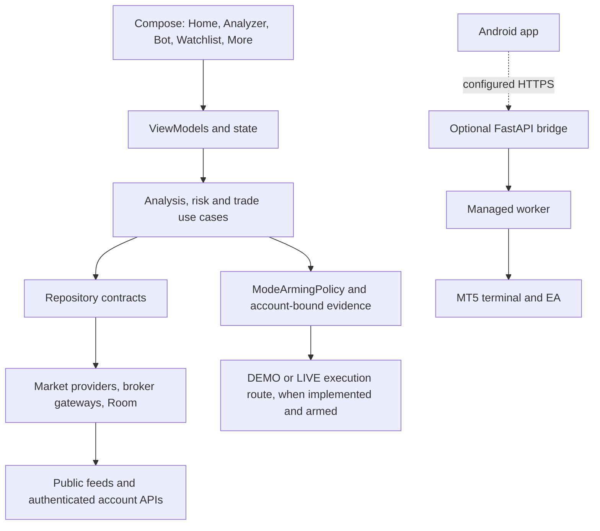

# DestinedFX Analyzer 5

DestinedFX Analyzer 5 is a native Kotlin and Jetpack Compose Android application for market analysis, account monitoring, and gated automated trading. The product requires explicit DEMO and LIVE authorization. Code presence does not prove that a broker account connects or that an order is accepted. No broker connection or real order was tested for this revision.

## Current implementation status

### Implemented in source

- Deterministic market analysis, signal validation, risk sizing, strategy selection, and local persistence in the Android app.
- Provider and market-data validation paths that retain source and time metadata where available. Provider event timestamps and retrieval timestamps are not interchangeable.
- A shared `ModeArmingPolicy` for account-bound DEMO acceptance, fresh identity evidence, process-local LIVE leases, reauthentication, typed confirmation, risk checks, lease expiry, credential rotation, and emergency disarm.
- Deriv Options multiplier submission code in the Deriv service. It checks authenticated account identity, current session evidence, DEMO acceptance or a LIVE lease, symbol/product support, current quote, and the Deriv-specific risk rules before a proposal or purchase request.
- MT5 remote bridge and EA integration source, with connector dispatch and account-mode checks. Android direct MT5 order methods remain disabled; managed host execution requires a configured bridge, a compatible terminal and EA, and fresh identity-matched evidence.
- cTrader OAuth/account-data integration is read-only today. cTrader order placement is not implemented.
- The generic `TradeUseCaseImpl` path now invokes `BrokerGateway.executeTradeWhenArmed`; the default mode decision fails closed. Adapters must use the shared policy before allowing that path, and the current Deriv generic Forex/CFD mapping and direct MT5 adapter do not submit orders.

### Incomplete or not verified

- No broker path is marked verified and running. Unit, fake-transport, source-contract, or build tests do not prove external connectivity, DEMO fills, LIVE orders, terminal performance, or deployment readiness.
- Deriv Options, cTrader, and MT5 account authentication require owner credentials, exact account identity, provider consent, and provider-side configuration. Never use real credentials in CI.
- MT5 host installation, broker-specific symbol and execution rules, Linux host viability, and Windows host operation require owner-side evidence and testing.
- cTrader trading, saved-account login UI, broker-specific compatibility, manual signal tickets, and full release evidence remain incomplete.
- TradingView charts and market-data adapters are separate from broker execution. A chart or public quote is not account evidence.

## Primary navigation

The primary workspaces are **Home, Analyzer, Bot, Watchlist, and More**. Strategies, Calendar, Risk, Settings, Chat, About, and other utilities remain available from More or their existing routes.

## Architecture

The Android project is organized by source-level responsibilities, not separate Gradle modules. `MyApplication` initializes app dependencies; Compose screens and ViewModels call use cases and repository contracts. Repositories connect to local Room storage, public market-data providers, and authenticated account gateways. Broker execution routes have their own mode checks and risk rules. The optional FastAPI bridge, Windows managed worker, and MT5 EA are separate components and are not needed for local analysis. They are not evidence of an active deployment.



See [system architecture](docs/architecture/SYSTEM_ARCHITECTURE.md), [application data flow](docs/architecture/APPLICATION_DATA_FLOW.md), [backend architecture](docs/architecture/BACKEND_ARCHITECTURE.md), and the [provider architecture](docs/architecture/PROVIDER_ARCHITECTURE.md).

## Repository map

```text
app/                         Android application, domain/data code and tests
  src/main/java/com/example/  Android UI, services, adapters and dependency setup
  src/main/java/com/destinedfx/core/ shared analysis, risk and trading core
  src/test/                   JVM and Robolectric tests
  src/androidTest/            device/emulator tests
bridge/                      FastAPI relay, API, deployment configuration and tests
managed-worker/               Windows worker and diagnostics
mt5-ea/                       MQL5 Expert Advisor source and tests
scripts/                      build, smoke, host and MT5 tools
docs/                         architecture, security, provider, deployment and setup guides
.github/workflows/            Android, Python, secret-scan and MT5 CI
```

## Build and test

Requirements include a full JDK compatible with the Gradle configuration, Android SDK/platform/build tools, Python for Chaquopy and Python test suites, and (for real EA compilation) Windows with MetaEditor as used by CI.

```sh
cp .env.example .env
./gradlew testDebugUnitTest --stacktrace
./gradlew assembleDebug --stacktrace
./gradlew connectedDebugAndroidTest --stacktrace  # requires a connected device or emulator
python -m pytest -q bridge scripts/test_deriv_demo_smoke.py
python -m pytest -q managed-worker mt5-ea
```

Install the bridge's requirements before running Python suites. See [Android setup](docs/development/ANDROID_SETUP.md), [build and test details](docs/development/BUILD_AND_TEST.md), and [CI/CD](docs/development/CI_CD.md). Tests with injected fakes are tests of local behavior only. Do not use test code to submit a real broker order.

## Configuration and security

- `.env.example` contains placeholders. Keep broker credentials, API secrets, tokens, private keys, and signing keys out of source control, APK resources, logs, and issue reports.
- Android secrets use the existing encrypted-storage path when available. Do not claim credentials were saved securely when secure storage is unavailable.
- The bridge has a separate server-side configuration. It must be deployed and secured by its owner; a repository file or health endpoint does not establish a live service.
- Live arming is account-specific and process-local. A process restart or expired lease must not restore LIVE authorization silently.
- DEMO acceptance must match the exact verified account and credential generation. Changes in account identity, stale evidence, risk failures, or missing authorization must block new orders.

Read the [security overview](docs/security/SECURITY_OVERVIEW.md) and [data provenance guide](docs/security/DATA_PROVENANCE.md) before changing credential or account flows.

## Owner setup and external verification

Broker connection steps require owner-controlled accounts, credentials, exact broker server names, application registration or provider approval where applicable, and host infrastructure for MT5. The app must not invent server names, create accounts, reset passwords, or perform real orders during development. Connection claims require a redacted evidence report returned by the owner. Current provider facts and unknowns are in the [capability matrix](docs/providers/PROVIDER_CAPABILITY_MATRIX.md) and [limitations](docs/providers/PROVIDER_LIMITATIONS.md).

## CI and APK

`.github/workflows/build-apk.yml` is the source of truth for branch triggers, test jobs, artifact names, and retention. The workflow includes Android build and JVM tests plus Python, managed-worker, MT5 EA, secret-scan, and emulator-related jobs as configured in that file. A CI run is evidence only for its exact commit and completed jobs. APK artifacts are debug builds, not production release packages. See [APK installation](docs/INSTALL_APK.md) and [deployment limitations](docs/deployment/KNOWN_LIMITATIONS.md).

## R1 go-live path

The owner-facing path is **Accounts > Add account**, exact broker/server entry, verified DEMO identity and heartbeat, then the existing DEMO acceptance and process-local LIVE lease gates. Login alone never enables trading. Review the [R1 go-live checklist](docs/deployment/GO_LIVE_CHECKLIST.md) before any owner-side verification. A deliberate `host-v*` tag packages the APK, genuine MetaEditor `DestinedFXTraderEA.ex5`, Windows worker kit, and SHA-256 checksums as a GitHub prerelease; no tag or release is created automatically by development work.

## Limitations and troubleshooting

- **No price or candles:** check the selected provider, symbol mapping, configuration, freshness, and upstream response. Missing data must remain unavailable rather than be replaced with sample values.
- **No verified account:** public market data is separate from authenticated account data. Check exact account identity, mode, consent, credentials, and fresh provider evidence.
- **Execution blocked:** inspect the policy reason, DEMO acceptance record, LIVE lease, account identity, risk/news/session checks, and host readiness. Do not bypass a block to obtain a test result.
- **Android SDK not found:** install the SDK and platform/build tools expected by Gradle, or use the hosted workflow.
- **MT5 host unavailable:** verify the owner-managed terminal, EA heartbeat, bridge identity, server, account mode, and network configuration. A reachable bridge alone is insufficient.

See [known limitations](docs/deployment/KNOWN_LIMITATIONS.md) and the [deployment overview](docs/deployment/DEPLOYMENT_OVERVIEW.md).

## License

No license has been selected. All rights and licensing choices remain with the repository owner.
