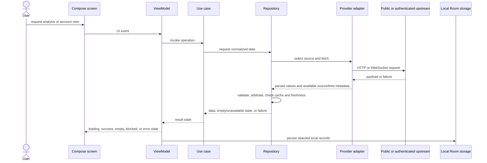
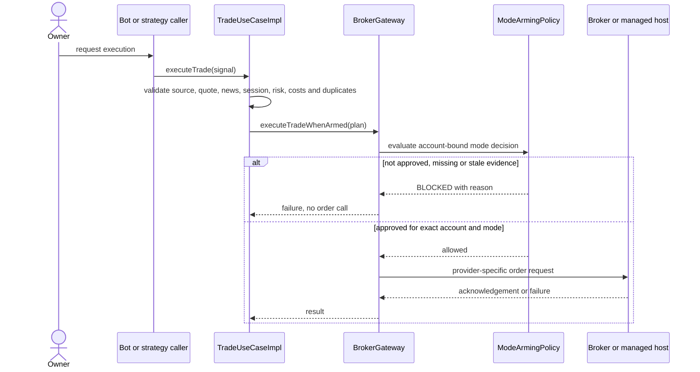

# Application data flow

This describes source paths. It does not establish provider availability or a verified account.

## Analysis and account data

`MainActivity` gates workspace creation on application initialization. ViewModels and repository contracts separate some responsibilities, but the app retains global service lookup and legacy service interactions.

## Execution path and gate

`BrokerGateway` defaults to `MODE_ARMING_POLICY_UNAVAILABLE`. A gateway implementation must derive an allow decision from the shared policy and fresh identity-matched evidence; a missing override denies. Deriv Multiplier submission and MT5 managed commands also have their provider-specific checks. Direct MT5 app orders are disabled. cTrader trading is not implemented.

## Market source selection and provenance

`MarketDataRepositoryImpl` selects a configured or default feed and caches candles by symbol and timeframe. TradingView scanner, Binance REST, OANDA REST/stream, and Deriv paths are distinct. They must not be silently combined as one feed. Some adapters stamp local retrieval time rather than provider event time. Local receipt time does not prove upstream freshness.

Quotes and candles are validated before analysis. Missing values remain unavailable; malformed candles must not be repaired into plausible OHLC. A failed calendar request is not the same as a verified empty event window. Cached data after a provider failure does not prove current coverage.

## Persistence and records

Analysis and other selected records use local Room and preferences. Account and trade records contain sensitive or financial information, so retention, deletion, migration, backup and recovery need continued review. Android cloud-sync classes must be described according to their actual implementation, not as available remote storage.

## Relevant code

- `app/src/main/java/com/example/data/market/MarketDataRepositoryImpl.kt`
- `app/src/main/java/com/example/data/market/MarketDataSafety.kt`
- `app/src/main/java/com/destinedfx/core/marketdata/MarketModels.kt`
- `app/src/main/java/com/destinedfx/core/marketdata/QuoteArbiter.kt`
- `app/src/main/java/com/example/domain/usecase/impl/TradeUseCaseImpl.kt`
- `app/src/main/java/com/example/data/broker/ModeArmingPolicy.kt`
- `app/src/main/java/com/example/data/AppDatabase.kt`

See [provider capability matrix](../providers/PROVIDER_CAPABILITY_MATRIX.md) and [data provenance](../security/DATA_PROVENANCE.md).
