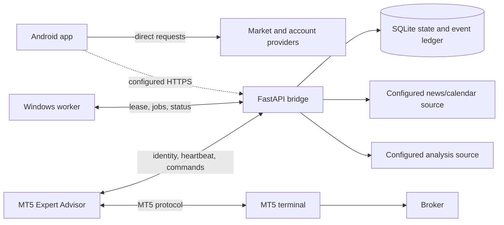

# Backend architecture and API status

## Role

Basic Android analysis can run without a remote application backend. The repository also contains a FastAPI bridge, a managed worker and an MT5 EA. These components support an optional owner-operated account/terminal path; they are not required for local analysis, and source presence does not prove an active deployment.

The bridge has pairing, account/terminal state, worker jobs, command exchange, analysis/news integrations and transaction-related operations. Authorization, account identity, `ModeArmingPolicy`, and terminal evidence are required before execution-sensitive actions. No remote service or broker connection was inspected or verified for this revision.

## Architecture

## Service configuration and deployment

Root `render.yaml` uses an ephemeral storage profile and is not an always-on MT5 host. `/health` is liveness; `/health/ready` checks only configured readiness conditions. Neither proves a broker session or a successful trade. Operator Docker/TLS and Windows deployment recipes still require owner-side setup and verification.

The app can receive a managed-service URL through the documented Gradle property, environment variable or `.env` setting. A syntactically valid HTTPS origin is not proof that it resolves to an authorized service. Keep secrets server-side and never commit them.

## API surface in source

Exact routes, payloads, authorization, idempotency and statuses are defined by `bridge/app.py` and [`docs/managed-execution-protocol.md`](../managed-execution-protocol.md). Source groups include:

| Route group | Role | Important limit |
|---|---|---|
| Health and readiness | Process, configuration and storage checks | No broker or market-data verification |
| Pairing and revocation | App and terminal identity lifecycle | Owner must protect credentials and enrollment |
| Terminal claim, heartbeat and commands | Worker/terminal status and command exchange | Fresh exact identity and mode evidence are required |
| Worker jobs | Lease-based provisioning and worker status | Requires a separate authorized worker |
| Analysis and news | Configured upstream requests | Provider response does not prove completeness or freshness |
| Account, trade history and execution commands | Managed account operations | Transaction-capable; must remain behind authorization, risk checks and reconciliation |

## Provider responsibility and data provenance

Android also has direct public-feed adapters. The bridge may fetch configured analysis/news data. Do not add an extra network hop without a product need. Source identity, timestamps and freshness must remain distinct. Missing config, stale or malformed data, untrusted sources and upstream errors must remain explicit failures.

## Security and operating constraints

A managed deployment requires operator-controlled HTTPS, protected secrets, durable storage for stateful operation, backups, a worker/terminal host and monitoring. Render Free storage is ephemeral and may sleep, so it is not a reliable always-on trading host. No infrastructure is provisioned by this documentation. Android Supabase auth/cloud-sync classes must not be described as functioning cloud services without implementation evidence.

See [security overview](../security/SECURITY_OVERVIEW.md), [bridge README](../../bridge/README.md), and [deployment overview](../deployment/DEPLOYMENT_OVERVIEW.md).
