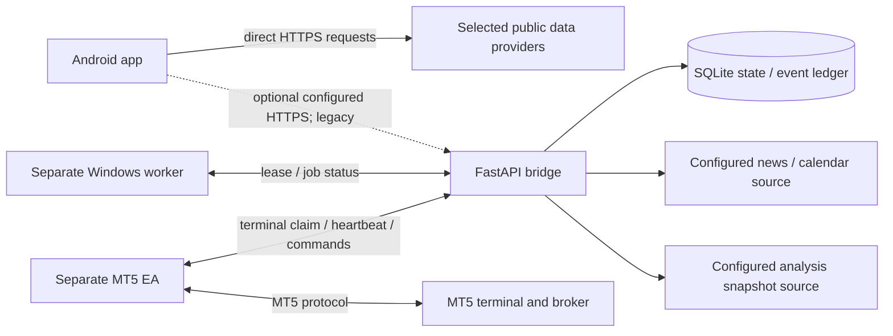

# Backend architecture and API status

## Is a backend required?

No backend is required for the basic Android-local analysis path in source. Public market-data adapters make direct requests from the app; Room stores local app data. The repository also contains a separate FastAPI bridge. That bridge is a legacy managed-execution control plane, not a required intermediary for the local analyzer and not a read-only backend. Its source includes pairing, management, terminal/worker messaging, command and trading-related paths.

The standalone bridge, managed worker, and MT5 EA are not verified as deployed or reachable. Do not provision or operate these components as part of an analysis-only release until the transaction-capable surfaces are removed or constrained and independently verified.

## Architecture diagram

## Service configuration and deployment

Root `render.yaml` configures a Free service with an ephemeral SQLite path and `EXECUTION_STORAGE_DURABLE=false`. `/health` is liveness; `/health/ready` checks readiness and execution-related configuration. The non-durable profile is diagnostic only, not a durable application backend. No deployment, endpoint, DNS/TLS configuration, or runtime health was verified. The operator-owned Docker/TLS and Windows deployment recipes are documentation, not a tested end-to-end service.

Basic Android analysis continues without the bridge. A configured bridge URL is required only for retained bridge-dependent paths and is selected by Gradle property `mt5ManagedServiceUrl`, environment variable `MT5_MANAGED_SERVICE_URL`, or root `.env`. Release builds require a public HTTPS origin-shaped value; source validation does not prove that the domain resolves safely or that the service is live.

## API contract in source

The bridge API is broad and includes execution-capable operations. The following groups are present; consult `bridge/app.py` and [`docs/managed-execution-protocol.md`](../managed-execution-protocol.md) for exact verbs, schemas, authorization and status behavior. Do not use this list as an endorsement to deploy it.

| API group | Purpose in source | Read-only assessment |
|---|---|---|
| `/health`, `/health/live`, `/health/ready` | Liveness/readiness and storage/configuration checks | Liveness alone does not establish provider or broker availability; non-durable readiness fails closed |
| `/v1/pairings`, app/terminal pairing and revocation routes | Enrollment and app/terminal identity lifecycle | Creates account/terminal relationships; not relevant to analysis-only use |
| `/v1/terminal/claim`, `/v1/terminal/heartbeat`, `/v1/terminal/commands` and acknowledgements | Terminal identity/status and command exchange | Includes command delivery; execution-sensitive |
| Worker job claim/update/status routes | Lease-based provisioning and worker readiness | Requires separate Windows worker and authenticated state |
| `/v1/app/analysis`, news verdict routes | Analysis request against configured upstream and news data | Responses are configured-source-dependent; source path is not external verification |
| `/v1/app/trades` and related account/event routes | Trade history and managed account state | Trade/account surfaces remain in source |
| live authorization and close/modify/order command routes | Legacy execution authorization and actions | Transaction-capable; excluded from intended phone-only product |

HTTP status, validation, token rules, idempotency, timestamps and body semantics are documented in the protocol document and code. No unnecessary endpoints are proposed for the Android analyzer.

## Provider responsibility and data provenance

The bridge may fetch an analysis snapshot from `ANALYSIS_PROVIDER_URL` with server-only token and trusted-source allowlist; it may request news/calendar evaluation from a configured `NEWS_PROVIDER_URL`. Missing config, stale or malformed data, untrusted sources, or upstream failures fail closed in source. This does not verify a provider contract, service key, network reachability, completeness, or current data.

The Android app also has direct public feed adapters. These requests are not automatically proxied through the bridge. Every extra network hop should have an explicit need (for example, a server-held secret); no bridge hop is necessary for unauthenticated public REST data unless a separate product requirement justifies it.

## Security and zero-cost constraints

Bridge deployments require operator-managed secrets, HTTPS, controlled access, storage durability/backup where state matters, and a worker/terminal host for managed MT5 operation. The repository does not provision free always-on execution infrastructure. Render Free is non-durable and may sleep; it is not a substitute for an always-on terminal. No paid hosting/API subscription should be made mandatory for local analyzer use.

Android Supabase authentication and cloud-sync classes currently return unavailable/no-op results. Do not describe them as working cloud services. For bridge security details and test commands, see [security overview](../security/SECURITY_OVERVIEW.md), [bridge README](../../bridge/README.md), and [deployment overview](../deployment/DEPLOYMENT_OVERVIEW.md).