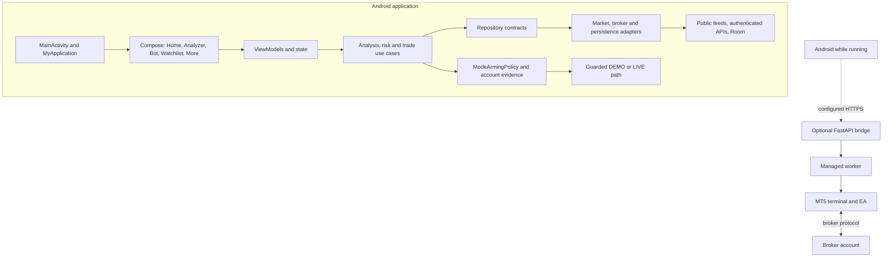

# System architecture

**Scope:** Source-level overview of `free/phone-only-v1`. This describes repository components, not a live deployment or broker connection.

## High-level view

A connection or trade claim requires fresh identity-matched evidence from the actual provider or terminal. No such owner-returned evidence was available for this source review.

## Component inventory

| Component | Location | Responsibility | Current source status |
|---|---|---|---|
| Android entry and composition | `app/src/main/java/com/example/MainActivity.kt`, `MyApplication.kt` | App initialization, root composition and dependency construction | Implemented; broad service-locator/global-state patterns remain |
| Presentation | `app/src/main/java/com/example/ui/` | Compose screens, ViewModels and interactions | Five primary workspaces are Home, Analyzer, Bot, Watchlist and More; other workspaces remain reachable from More |
| Domain and shared core | `app/src/main/java/com/example/domain/`, `app/src/main/java/com/destinedfx/core/` | Analysis, risk, signals, policy, use cases and contracts | Implemented in the Android project; not isolated into separate Gradle modules |
| Market data | `app/src/main/java/com/example/data/market/`, calendar and news packages | Provider selection, parsing, freshness and source mapping | Several paths exist; external availability and exact event-time semantics are not verified |
| Broker/account paths | `app/src/main/java/com/example/data/broker/`, `deriv/`, `ctrader/`, `mt5/` | Authenticated account state and provider-specific operations | Mixed maturity. Mode checks exist; cTrader trading is not implemented, and direct Android MT5 orders fail closed |
| Mode authority | `ModeArmingPolicy.kt`, `SecretsManager.kt` | Exact-account DEMO acceptance and expiring process-local LIVE leases | Source and unit tests exist; external account verification is not established |
| Bridge, worker and EA | `bridge/`, `managed-worker/`, `mt5-ea/` | Optional remote command, worker and MT5 terminal path | Source and tests exist; no running deployment or real terminal was verified |
| Persistence | `app/src/main/java/com/example/data/` | Room records, encrypted preferences and local state | Implemented; full retention/deletion/privacy audit remains outstanding |
| CI | `.github/workflows/build-apk.yml` | Python, secret scan, MetaEditor, Android build/instrumentation and artifact jobs | Workflow source restores the broad pipeline; only exact-run results prove job status |

## Execution controls

`TradeUseCaseImpl.executeTrade` validates the trade plan and calls `BrokerGateway.executeTradeWhenArmed`. The gateway's default mode decision denies submission. An adapter may permit the request only when it evaluates the shared `ModeArmingPolicy` with fresh, account-matched evidence. The Deriv multiplier service and the MT5 remote connector have separate provider-specific checks. Direct Android MT5 order methods remain disabled. cTrader trading is not implemented.

DEMO needs a matching owner acceptance record and fresh account verification. LIVE needs the matching DEMO pass, current LIVE verification, owner reauthentication, typed confirmation, required risk checks and an unexpired process-local lease. Process restart, credential rotation, identity changes, stale evidence and emergency stop must not silently retain authorization.

## Lifecycle and verification boundary

`MyApplication` is the current composition root, with `AppContainer` and `ServiceLocator` patterns also present. Initialization and process-death recovery require further review. A source method, unit test, compiled EA, HTTP response, OAuth grant or APK build does not prove broker connectivity, order acceptance, fill reconciliation or continuous host operation.

See [application data flow](APPLICATION_DATA_FLOW.md), [backend architecture](BACKEND_ARCHITECTURE.md), [provider architecture](PROVIDER_ARCHITECTURE.md), and [build and test](../development/BUILD_AND_TEST.md).
