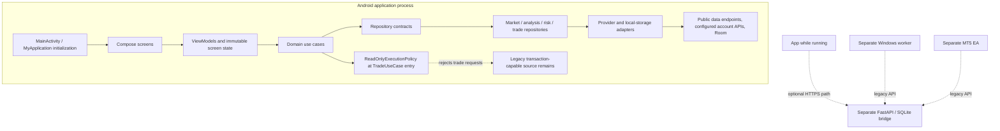

# System architecture (current source audit)

**Scope:** `free/phone-only-v1`, audited at starting revision `9ac48a8c0bfe351bb666ba3694768d6b7ec23410`. The branch has since had documentation updates; this document describes that source baseline and should be refreshed when implementation changes. It is not a deployment or external-provider verification report.

## High-level view

The dotted bridge/worker/EA path is not a supported read-only product flow. The repository still contains transaction-capable code in these packages. No hosted instance, remote account, or runtime connectivity was verified.

## Component inventory

| Component | Location | Responsibility | Implementation status (source evidence) | Important dependencies |
|---|---|---|---|---|
| Android entry point | `app/src/main/java/com/example/MainActivity.kt`, `MyApplication.kt` | Activity, app initialization, root composition and object construction | Implemented; broad application/service-locator style | AndroidX, Compose, repositories/use cases |
| Presentation | `app/src/main/java/com/example/ui/`, `presentation/`, `viewmodel/` | Compose screens, events, state and user interactions | Implemented; legacy workstation sources remain; Bot is absent from primary navigation and old destination discloses read-only scope | Compose, lifecycle, ViewModels |
| Domain | `app/src/main/java/com/example/domain/`, `com/destinedfx/core/` | Models, analysis/risk rules, use cases, repository contracts | Implemented; not a separate Gradle module | Kotlin, Coroutines; Python quantitative parity component |
| Data/repositories | `app/src/main/java/com/example/data/` | Provider orchestration, persistence, network adapters, mapping | Implemented with legacy compatibility paths; not uniformly verified | OkHttp/Retrofit/Moshi, Room, Coroutines |
| Market providers | `data/market/`, `core/marketdata/`, calendar/news packages | Public quote/candle/event feeds and validation | Several adapters in source; runtime config and external availability unverified | TradingView scanner, Binance REST, OANDA REST/stream, FMP/calendar sources |
| Broker adapters | `data/broker/`, `data/deriv/`, `data/ctrader/`, `data/mt5/` | Account/provider-specific status and selected data paths | Mixed: explicit unavailable/preview paths, read-only cTrader path, authenticated Deriv and remote MT5 source; transaction-capable code remains | Provider credentials, WebSocket/HTTP, optional bridge |
| Application backend | `bridge/` | FastAPI/SQLite relay, pairing, status, command, analysis/news and managed execution APIs | Implemented as source; transaction-capable; no deployment verified | Python, SQLite, configured secrets/providers, TLS deployment |
| Worker/EA | `managed-worker/`, `mt5-ea/` | Windows process/terminal orchestration and MT5 integration | Separate legacy execution-oriented components; not verified here | Windows, MT5 terminal, EA, bridge, secrets |
| Local persistence | `app/src/main/java/com/example/data/` | Room and preferences-backed local records | Implemented; database version 6; retention/deletion behavior not comprehensively audited | Room, DataStore, AndroidX Security Crypto |
| CI/CD | `.github/workflows/build-apk.yml`, `scripts/verify_read_only_build.py` | Static boundary verification, Android JVM tests and debug APK creation | Workflow definition present; source audit does not itself prove hosted success | GitHub Actions, Java 21, Android SDK/build tools |

## Android boundary

`TradeUseCaseImpl.executeTrade` invokes `ReadOnlyExecutionPolicy.requireTradingDisabled()` before broker lookup, market reads, journaling, or submission. This establishes a guard at that use-case entry path, not a repository-wide property: gateway interfaces and legacy implementations still contain transaction methods. A future hardening pass must identify every invocation path and ensure unsupported code is removed or unreachable in every packaged artifact.

The main manifest contains no service or receiver declarations for the retained bot/session services or boot receiver. Source retention, a particular manifest state, or a unit test of the guard does not prove every route or build configuration is safe.

## Dependency and lifecycle notes

`MyApplication` is the broad composition root and exposes global state; `AppContainer` creates the root ViewModel, while `ServiceLocator` is another lookup path. This is existing structure, not a recommendation to proliferate global access. Repositories use coroutine dispatchers and provider-specific timeout/cancellation patterns. Resource cleanup, backgrounding, process death and recovery are not uniformly verified.

## Verification boundary

Source-level checks and tests are enumerated in [build and test](../development/BUILD_AND_TEST.md). Passing a static verifier or fixture-based test does not prove live provider availability, broker acceptance, absence of separately deployable execution paths, or end-to-end read-only operation.